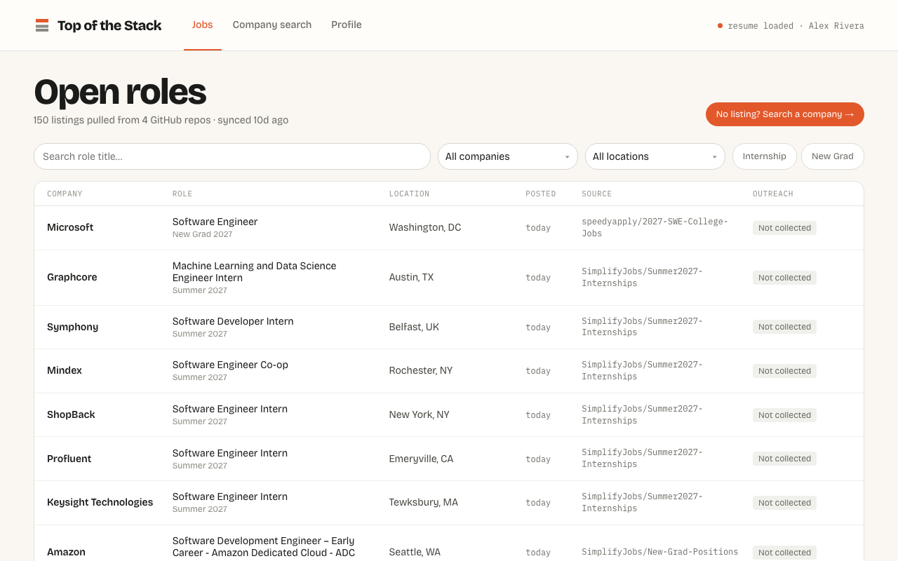

# Top of the Stack

**2nd place, BYUHack.** A job-seeker's outreach console: it pulls internship and new-grad listings from public GitHub job boards, finds people and recruiters at each company, and drafts personalized referral requests and recruiter emails from your resume.



## What it does

- **Job feed.** A GitHub Action scrapes public job-board repos daily into `data/jobs.json`, which the app serves as a filterable list of open roles.
- **Recruiter email search.** Three Claude agents with web search run in parallel, each with a different search strategy (the role's hiring team, the company's own pages, third-party sources). The first validated email wins and the others are cancelled. The agents are told never to guess an address from a naming pattern, and the server rejects malformed and placeholder addresses.
- **Drafting.** Claude drafts the recruiter email from your profile and resume. LinkedIn referral notes and intro requests start from templates filled with your profile, and you can have Claude rewrite any draft with a one-line instruction.
- **LinkedIn capture.** A Chrome extension saves the people from company-scoped LinkedIn searches you open from the app, including 2nd-degree connections and your shared mutuals, so you can ask for a warm intro. Failed saves go into a retry queue with idempotency keys.

## Architecture

| Part | Path | Stack |
|---|---|---|
| Web app | `frontend/` | React, TypeScript, Vite |
| API server | `server/` | Node, Express, SQLite (`node:sqlite`), Anthropic SDK, OpenAPI docs at `/docs` |
| Chrome extension | `extension/` | TypeScript, esbuild, Manifest V3 ([README](extension/README.md)) |
| Job scraper | `scraper/`, `.github/workflows/scrape-jobs.yml` | Node, GitHub Actions |

Design specs for each feature are in [`docs/`](docs/).

## Running locally

Requires Node 22 or newer and an Anthropic API key.

```bash
# API server on 127.0.0.1:3001
cd server
npm install
echo "ANTHROPIC_API_KEY=sk-ant-..." > .env
npm run dev

# Web app on localhost:5173 (proxies /api to the server)
cd frontend
npm install
npm run dev
```

To load the extension, see [extension/README.md](extension/README.md).

Tests: `npm test` in `server/` and in `extension/`.

## Team

Garrett Thomas, Aaron Thayer, Orion
